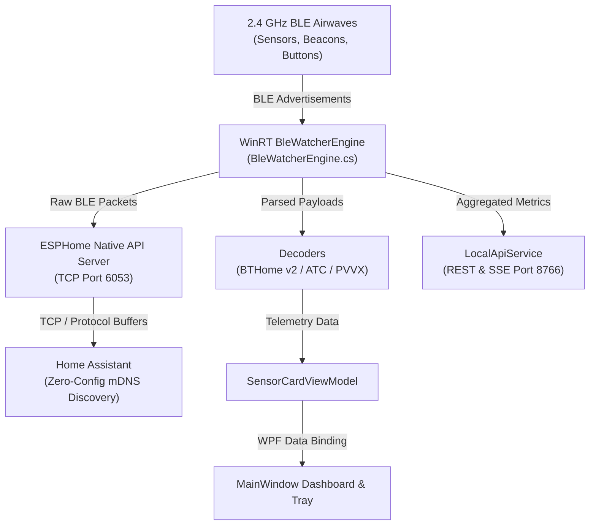

<p align="center">
  
</p>

<h1 align="center">AirFoxBT</h1>

<p align="center">
  <strong>Windows Native, Zero Pairing, BT Home Gateway</strong>
</p>

<p align="center">
  <a href="https://github.com/TalviFox/AirFoxBT/releases/latest"></a>
  
  
  
  
  
  <a href="LICENSE.md"></a>
  <a href="https://ko-fi.com/talvisden"></a>
</p>

---

AirFoxBT is a zero-driver, zero-privilege Windows background service and desktop tray gateway. Part of the **FoxDen Software** suite (alongside *inFaux* and *WireFox*), it turns any Windows 10, Windows 11, or Windows Server machine into an ESPHome Bluetooth Proxy (port 6053) for Home Assistant. 

AirFoxBT passively sniffs 2.4 GHz airwaves using your PC's Bluetooth adapter or high-gain desktop antenna, decodes beacon telemetry in real time, and streams raw frames directly to Home Assistant over TCP without pairing, bonding, or custom drivers.

Run it completely headless from the CLI or minimized in your system tray, or if you prefer, pop open the rich dark-mode desktop GUI to inspect live sensor cards, RSSI signal meters, and raw BLE ingestion frames in real time.



---

## Key Features

### Zero-Driver Native WinRT
Runs entirely in user mode through native Windows Runtime APIs (`BluetoothLEAdvertisementWatcher`). No Zadig, WinUSB, libusb, or kernel filter drivers required. Your existing Bluetooth mice, keyboards, and headsets keep working normally without interruption.

### Native ESPHome Proxy Protocol (Port 6053)
Implements the official ESPHome Native API Bluetooth Proxy specification. Home Assistant connects directly over TCP port 6053, populating sensors automatically in BTHome, Shelly BLE, and Xiaomi BLE integrations.

### Zero-Collision Multicast DNS
Broadcasts `_esphomelib._tcp.local` from an ephemeral outbound port, avoiding `WSAEADDRINUSE` port 5353 collisions with Windows Dnscache so Home Assistant discovers the proxy instantly on your network.

### Smart Keepalive Relay Buffer
Deep-sleeping sensors like the Shelly BLU Door / Window only broadcast when triggered. AirFoxBT caches their verified state and synthesizes periodic keepalives into the proxy stream so Home Assistant never marks your contact sensors unavailable. Includes per-device toggle switches on every card.

### Multi-Format Decoders
Decodes standard BTHome v2 (`0xFCD2`) payloads (temperatures, humidities, door/window contacts, tilt, illuminance, battery) as well as custom ATC and PVVX firmware (`0x181A`) on Xiaomi Mijia and Tuya thermometers. Thermometer readings retain priority over transient button wake bursts.

### Rate Limiting and Deduplication Presets
Switch between four deduplication profiles on the fly:
- `Eco`: 15-second deduplication window for crowded airwaves.
- `Balanced`: 5-second deduplication window (default profile).
- `Realtime`: 1-second deduplication window for fast updates.
- `Raw`: Unfiltered firehose streaming every packet directly to Home Assistant.

### Embedded REST and SSE API (Port 8766)
Provides JSON endpoints at `http://localhost:8766/api/sensors`, live packet counts at `/api/stats`, and a Server-Sent Events stream at `/api/stream`.

---

## Quick Start

### One-Liner PowerShell Installer

Install AirFoxBT directly into `%LOCALAPPDATA%\Programs\AirFoxBT` without administrator privileges:

```powershell
irm https://raw.githubusercontent.com/TalviFox/AirFoxBT/main/install.ps1 | iex
```

The installer automatically stages the executable, configures Windows startup shortcuts, creates Desktop and Start Menu entries, and offers automatic Windows Firewall configuration.

### Cryptographic Verification

Verify release binary authenticity against official GitHub release SHA-256 hashes before executing:

```powershell
irm https://raw.githubusercontent.com/TalviFox/AirFoxBT/main/verify.ps1 | iex
```

### Running Manually

Download `AirFoxBT.exe` from the latest release and run it directly:

```powershell
.\AirFoxBT.exe
```

Command line arguments:
- `--minimized`: Starts AirFoxBT minimized directly in the Windows system notification area.
- `--firewall`: Checks and prompts to configure inbound Windows Firewall rules for TCP ports 6053 and 8766.

### Uninstallation

To remove AirFoxBT, its registry startup keys, and shortcuts cleanly:

```powershell
irm https://raw.githubusercontent.com/TalviFox/AirFoxBT/main/uninstall.ps1 | iex
```

---

## Home Assistant Integration

Once AirFoxBT is running on your Windows PC:

1. Open **Home Assistant** and navigate to **Settings** -> **Devices & Services**.
2. AirFoxBT will appear automatically under **Discovered** as an **ESPHome** device (e.g. `AirFoxBT (HOSTNAME)`).
3. Click **Configure**, submit without encryption key (unless configured), and confirm the pairing.
4. Your BLE sensors within range will immediately appear in Home Assistant under their respective Bluetooth integrations (BTHome, Shelly BLU, Xiaomi BLE).

If Home Assistant resides on an isolated VLAN where mDNS multicast does not cross the boundary, simply click **Add Integration** -> **ESPHome**, and enter your Windows PC's IPv4 address with port `6053`.

---

## Building from Source

### Prerequisites
- Windows 10 (Build 19041+) or Windows 11
- .NET 10.0 SDK

AirFoxBT builds with the standard .NET CLI. The release binary is self-contained with no runtime dependencies for end users:

```powershell
# Standard debug build
dotnet build

# Release compilation
dotnet build -c Release
```

### Creating Release Packages
To compile a single-file, self-contained binary packaged with FoxDen release artifacts, run the automated release pipeline:

```powershell
powershell -ExecutionPolicy Bypass -File .\release.ps1 -Version 1.0.1
```

The resulting artifacts, checksum tables, and release notes will be generated directly into the `publish/` directory.

---

## Support

If AirFoxBT made your Windows BLE setup easier or saved you from buying extra hardware dongles, feel free to support development on [Ko-fi](https://ko-fi.com/talvisden).

---

## License & Attribution

AirFoxBT is licensed under the **PolyForm Noncommercial License 1.0.0**. You are free to inspect, modify, fork, and run this software for personal and non-commercial home automation setups.

AirFoxBT is an independent open-source project by **FoxDen Software** and is not affiliated with, sponsored by, or endorsed by ESPHome, Nabu Casa, or Home Assistant.
