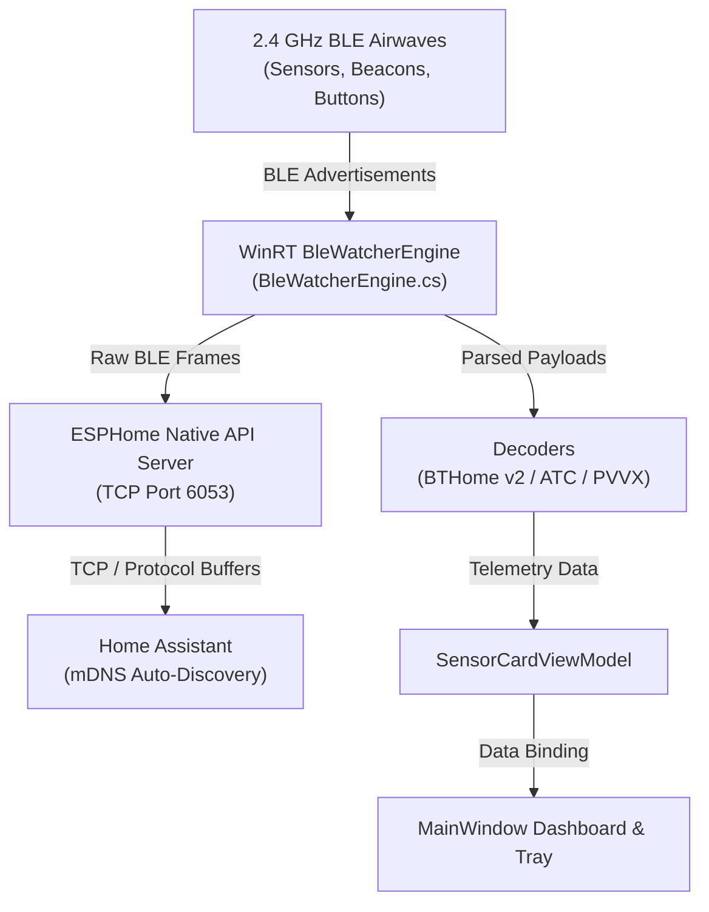

# AirFoxBT Technical Specification

## 1. Architecture Overview

AirFoxBT is a zero-driver Windows (or Windows Server) background service and desktop tray gateway. It turns a Windows 10/11 workstation or mini-PC into an active Bluetooth Low Energy listener and ESPHome Bluetooth Proxy (port 6053) for Home Assistant.



### Key Components

- **BleWatcherEngine (`Engine/BleWatcherEngine.cs`)**: Built on native Windows WinRT APIs (`Windows.Devices.Bluetooth.Advertisement.BluetoothLEAdvertisementWatcher`). Runs in active scanning mode to trigger microsecond scan requests for friendly device names without pairing.
- **EsphomeProxyServer (`Engine/EsphomeProxyServer.cs`)**: Native TCP server on port 6053 implementing the ESPHome Bluetooth Proxy Protocol Buffers protocol. Bridges raw advertisement frames directly to Home Assistant.
- **MdnsService (`Services/MdnsService.cs`)**: Multicast DNS responder announcing `_esphomelib._tcp.local` for zero-configuration discovery in Home Assistant.
- **ProxyThrottle (`Engine/ProxyThrottle.cs`)**: Per-device rate-limiting and deduplication engine with 4 presets:
  - Eco: 15-second deduplication window
  - Balanced: 5-second deduplication window
  - Realtime: 1-second deduplication window
  - Raw: No deduplication (unfiltered firehose)
- **SensorStorageService (`Services/SensorStorageService.cs`)**: Persists customized sensor aliases, ignore flags, and calibration offsets in `%AppData%\FoxDen\AirFoxBT\sensors.json`.

---

## 2. Beacon Decoding & Protocols

### BTHome v2 (`0xFCD2`)
Broadcast under Service Data UUID `0xFCD2` (or Manufacturer ID `0xFCD2`):
- Byte 0: Device Information Header (Bit 0 = encryption flag, Bit 2 = trigger device, Bits 5-7 = version 2)
- Bytes 1..N: Payload Type-Length-Value (TLV) chunks

Supported Object IDs:
- `0x00`: Packet ID / Counter (uint8, scale 1)
- `0x01`: Battery Percent (uint8, scale 1, %)
- `0x02`: Temperature (sint16 LE, scale 0.01, °C)
- `0x03`: Humidity (uint16 LE, scale 0.01, %)
- `0x05`: Illuminance (uint24 LE, scale 0.01, lux)
- `0x11`: Opening (uint8, 0 = closed, 1 = open)
- `0x1A`: Door (uint8, 0 = closed, 1 = open)
- `0x21`: Window (uint8, 0 = closed, 1 = open)
- `0x2D`: Contact (uint8, 0 = closed, 1 = open)
- `0x39`: Tilt / Rotation (sint16 LE, scale 0.1, °)
- `0x3A`: Button Event (uint8: 0 = none, 1 = press, 2 = double press, 3 = triple press, 4 = long press)
- `0x45`: Temperature (sint16 LE, scale 0.1, °C)

### ATC / PVVX Firmware (`0x181A`)
Parses custom open-source firmware payloads on Xiaomi Mijia (LYWSD03MMC) and Tuya thermometers under UUID `0x181A`:
- Offset 6-7: Temperature (sint16 LE, 0.01 or 0.1 scale)
- Offset 8-9: Humidity (uint16 LE, 0.01 or 1.0 scale)
- Offset 12: Battery Percent (uint8)

### Telemetry Display Precedence
Environmental telemetry (temperature and humidity) retains strict rendering precedence over transient button events (`0x3A`). A single click or wake burst on a thermometer like the Shelly SBHT-103C will never demote the sensor card into a remote clicker.

---

## 3. The Shelly Time Beacon & Radio Notes

### Initial Goal
I investigated having AirFoxBT broadcast authentic Shelly time beacons (`0x0BA9` / `0x0D`) so e-ink displays like the Shelly BLU H&T (SBHT-103C) could automatically sync their internal clocks over BLE without an active Bluetooth connection.

### Packet Comparison

#### Authentic Shelly Plug (Working)
```text
Raw Length : 28 bytes
Packet Type: ADV_IND (Connectable Undirected)
MAC Type   : Public Identity Address (TxAdd = 0)
Hex Dump   : 02-01-06-18-FF-A9-0B-0D-F2-C5-CE-6A-B0-B9-FF-FF-70-1E-AD-69-60-D5-E6-6A-10-0E-00-00
```
- `02-01-06`: AD Flags (General Discoverable)
- `18-FF`: Manufacturer Data Header (Length 24, Type 0xFF)
- `A9-0B`: Allterco Robotics / Shelly (`0x0BA9`)
- `0D`: Time & Timezone Block ID (byte offset 7)
- Followed by 4-byte Unix timestamp, 4-byte UTC offset, 4-byte DST start, 4-byte DST end, and 4-byte DST shift.

#### Windows User-Mode Output (`BluetoothLEAdvertisementPublisher`)
```text
Raw Length : 25 bytes
Packet Type: ADV_NONCONN_IND (Non-connectable)
MAC Type   : Random Resolvable Private Address (TxAdd = 1)
Hex Dump   : 18-FF-A9-0B-0D-BD-C9-CE-6A-B0-B9-FF-FF-70-1E-AD-69-60-D5-E6-6A-10-0E-00-00
```

### Why Windows User-Mode and Telink Clashed
1. **Windows Kernel Protection (`bthport.sys`)**: Microsoft intentionally blocks user-mode apps from transmitting AD Type `0x01` (Flags) to prevent spoofing Apple Continuity, AirDrop, or Quick Share packets. Adding `0x01` Flags throws an immediate kernel abort (`BTH_ERROR_INVALID_HCI_PARAMETER`). Windows also forces `ADV_NONCONN_IND` and random rotating MAC addresses (RPA).
2. **Telink Scanner Filter**: Under the Bluetooth Core Specification, a passive broadcast time beacon is non-connectable and has no business requiring `ADV_IND` or `02-01-06` Flags. However, the Telink firmware in the SBHT-103C hardcoded a rigid match against the default output of an ESP-IDF example on an ESP32 plug. Even when synthetic padding was used to align byte offset 7, the display rejected the frame because it specifically checked for `ADV_IND` and `02-01-06`.

### Resolution & Archival
To preserve AirFoxBT's identity as a clean, zero-driver, whisper-quiet passive gateway, time transmission was removed from the active product. All research, GATT management tools, and packet captures were preserved in a dedicated local archive.

---

## 4. Potential Future Solutions for Display Time Sync

If display clock synchronization is ever revisited, here are the viable pathways:

1. **Shelly Firmware Update**: Shelly updating the SBHT-103C firmware to walk the AD TLV structure properly and accept standard `ADV_NONCONN_IND` beacons or Service Data `0x16` under UUID `0xFCD2`.
2. **Hybrid Background Auto-Sync**: AirFoxBT listening passively with `BleWatcherEngine`. When a user clicks the display's rear button to wake it into its 60-second connectable window, AirFoxBT connects over standard Windows WinRT GATT for 1-2 seconds in the background, writes the clock register, and disconnects automatically.
3. **ESPHome Proxy Forwarding**: Delegating the broadcast frame to an existing ESP32 proxy or Shelly wall plug on the local network via Home Assistant.
4. **KMDF Lower Filter Driver**: A signed kernel filter driver sitting above `bthusb.sys` to inject raw HCI packets (`0x2006`, `0x2008`, `0x200A`) directly into the Bluetooth controller without breaking standard Windows Bluetooth services.
5. **USB Co-Processor Dongle**: An inexpensive ($3) ESP32-C3 or nRF52840 USB stick using standard Windows inbox `usbser.sys` serial communication to broadcast 24/7.
